# 精锐计量称重软件 使用说明书

**适用版本：V1.0.0**

本说明书面向磅房操作员和管理员，用通俗的语言介绍软件的每一个功能。不需要懂电脑专业知识，照着步骤做即可。

---

## 目录

1. [软件是干什么的](#1-软件是干什么的)
2. [安装软件](#2-安装软件)
3. [登录](#3-登录)
4. [认识主界面](#4-认识主界面)
5. [日常称重操作（最常用）](#5-日常称重操作最常用)
6. [视频监控与自动抓拍](#6-视频监控与自动抓拍)
7. [查记录、补打磅单、导出](#7-查记录补打磅单导出)
8. [报表统计](#8-报表统计)
9. [自定义字段](#9-自定义字段)
10. [串口设置（连接地磅仪表）](#10-串口设置连接地磅仪表)
11. [磅单打印设置](#11-磅单打印设置)
12. [磅单模板（自己设计磅单样式）](#12-磅单模板自己设计磅单样式)
13. [用户管理](#13-用户管理)
14. [修改密码](#14-修改密码)
15. [数据备份与恢复](#15-数据备份与恢复)
16. [数据库设置（单机版 / 网络版）](#16-数据库设置单机版--网络版)
17. [常见问题与故障排查](#17-常见问题与故障排查)
18. [附录：软件目录说明](#18-附录软件目录说明)

---

## 1. 软件是干什么的

本软件用于**地磅称重管理**，核心工作方式是"**两次称重**"：

- 车辆拉货进厂，第一次上磅称重（装货前或卸货前），叫 **一次磅**；
- 车辆装/卸完货，第二次上磅称重，叫 **二次磅**；
- 软件自动把两次重量中**大的当毛重、小的当皮重**，算出**净重**（货物实际重量），并打印磅单。

**不管先称空车还是先称重车，顺序无所谓**，软件都会自动算对。

除了称重，软件还能：

- 实时显示地磅重量（稳定/动态/超载一目了然）
- 连接摄像头看监控，称重时**自动拍照留证**
- 查询历史记录、补打磅单、导出 Excel / PDF
- 日报表、按货物/单位/车号/司磅员汇总统计
- 自己设计磅单样式
- 数据自动备份，防止数据丢失

---

## 2. 安装软件

### 2.1 安装

双击安装包（例如 `精锐计量称重软件_安装包_V1.0.0.exe`），按向导一路"下一步"即可：

- 默认安装到 `C:\精锐计量称重软件`（可以点"浏览"换到其他磁盘）；
- 建议勾选"创建桌面快捷方式"，以后从桌面双击图标打开软件。

> **提示：** 软件不需要安装任何其他运行环境（自带 .NET 运行时），装完即用。

### 2.2 升级 / 换新电脑

想沿用原来的**串口配置、登录密码、称重记录**？只需把旧安装目录里的两个东西拷到新安装目录：

- `config.json`（配置文件）
- `data` 文件夹（里面的 `weigh.db` 是数据库）

### 2.3 卸载

从 Windows"设置 → 应用"或"控制面板 → 程序和功能"里找到"精锐计量称重软件"卸载。

> **放心卸载：** 卸载只删程序本身，称重记录、配置、照片都会保留在安装目录里。

---

## 3. 登录

打开软件后先弹登录窗口。

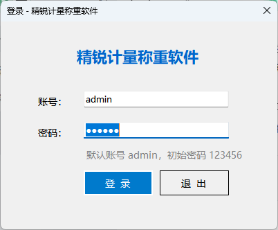

*图 3-1　登录界面*

| 项目 | 说明 |
|---|---|
| 默认账号 | `admin`（已自动填好） |
| 初始密码 | `123456` |

**操作：** 输入密码后直接按**回车键**即可登录。

**几个保护规则：**

- **第一次登录**会强制要求修改初始密码，不修改进不了系统（防止所有人都知道初始密码）；
- 密码连错 **5 次**，账号锁定 **10 分钟**，锁定期间谁也登不进；
- 每个操作员建议用各自的账号登录（找管理员开通），因为每条称重记录都会记下**司磅员是谁**。

---

## 4. 认识主界面

主界面从上到下分为几块：

```
┌──────────────────────────────────────────────────┐
│  菜单栏（系统 / 记录 / 报表 / 资料 / 数据源 / 视频）        │
├──────────────────────────────────────────────────┤
│  重量显示区：超大数字实时重量 + ●稳定/●动态/●超载 + ●通讯灯  │
├──────────────────────────┬───────────────────────┤
│  信息录入区：              │   一次磅未完成列表        │
│  车号、扣重、货物、备注、    │   （等二次磅的车辆，        │
│  司磅员（自动填）           │    超过24小时整行标红）     │
├──────────────────────────┴───────────────────────┤
│ [保存]  [清空录入]                                 │
├──────────────────────────┬───────────────────────┤
│  采集信息列表（最近100条）    │   视频监控（实时画面）     │
├──────────────────────────┴───────────────────────┤
│  状态栏：数据源 | 操作提示 | 时钟                      │
└──────────────────────────────────────────────────┘
```

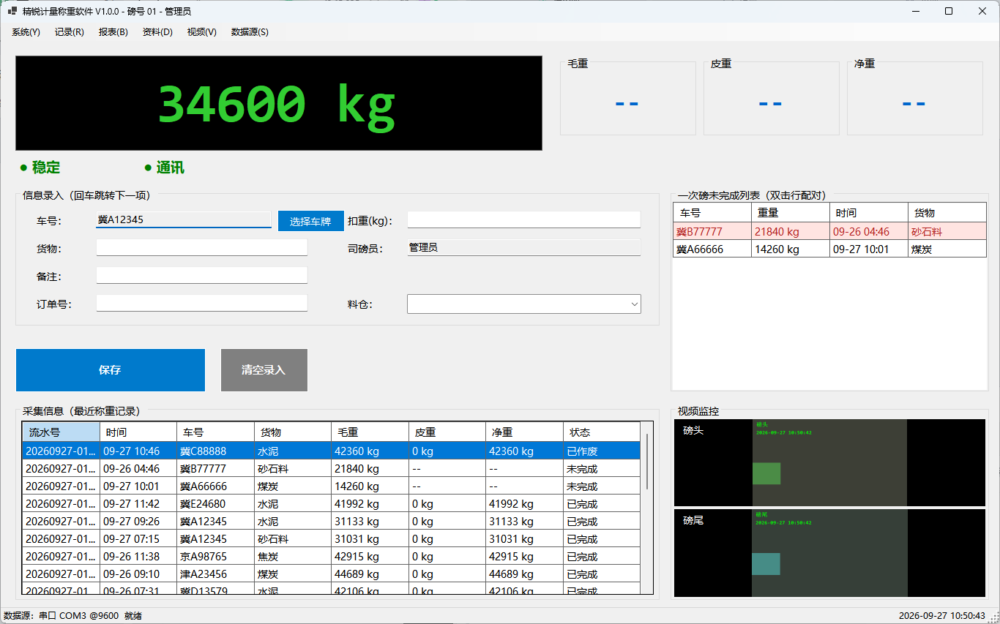

*图 4-1　主界面全貌（图中视频区为未接摄像头时的模拟画面，重量为示例数据）*

重量数字区域放大看是这样：

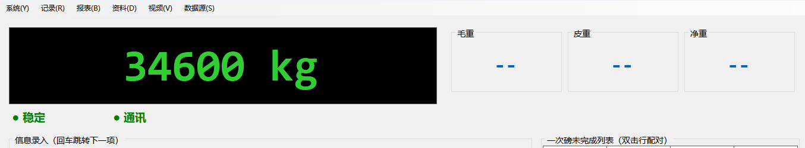

*图 4-2　重量显示区（左：实时重量大字与指示灯；右：毛重/皮重/净重三栏）*

**重点看三个指示灯：**

| 指示灯 | 颜色含义 | 怎么处理 |
|---|---|---|
| ● 通讯 | **绿色** = 正常收到地磅仪表数据；**红色** = 收不到 | 红色说明仪表没连上，见 [第 17 章](#17-常见问题与故障排查) 排查 |
| ● 稳定/动态 | **绿色"稳定"** = 重量读数稳了，可以保存；**橙色"动态"** = 数字还在跳，不能保存 | 等车停稳、数字不跳了再保存 |
| 超载 | **红色** = 超过地磅最大量程 | 把车开下去，禁止保存 |

**保存按钮会"变脸"：**

- 蓝色"**保存**" → 这次称的是**一次磅**（新车第一次称）；
- 绿色"**保存二次磅（结算）**" → 输入的车号有一次磅没完成的记录，这次保存就直接**结算出净重**。

---

## 5. 日常称重操作（最常用）

这是磅房每天要做的事，一共就两大步。

### 5.1 一次磅（第一次称重）

**第 1 步：确认通讯灯是绿色**（红色先去 [第 10 章](#10-串口设置连接地磅仪表) 处理串口）。

**第 2 步：车上磅，等数字稳定。**
看大字重量从橙色"动态"变成绿色"稳定"。

**第 3 步：点「选择车牌」按钮。**
弹出车牌软键盘：

- 先点**省份**（如"冀"），自动跳到字母数字页；
- 再依次点字母和数字，顶部实时显示完整车牌；
- 点错了按"⌫ 删除"或"清空"重来；
- 点"**确认**"。

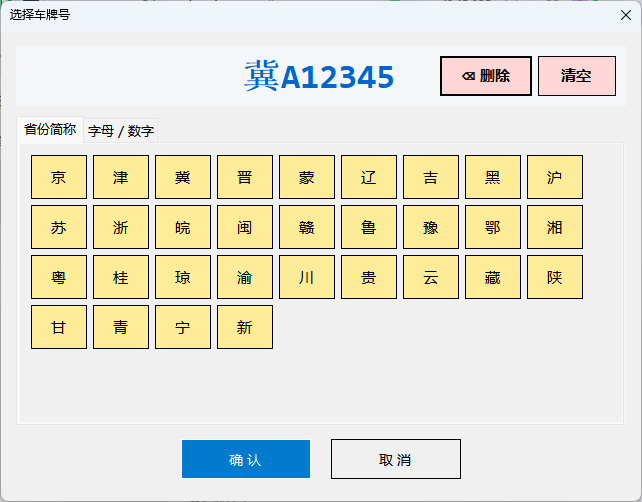

*图 5-1　车牌软键盘（选省份后自动跳到字母数字页）*

**第 4 步：填其他信息。**
按回车键依次跳到下一项：扣重（有扣杂、扣包装时才填）→ 货物 → 备注。填完最后一项按回车可直接保存。

**第 5 步：点「保存」。**
- 弹出确认框，核对**车号和重量**无误后点"是"；
- 保存成功后录入框自动清空，右侧"一次磅未完成列表"出现这辆车，摄像头**自动抓拍**留证照片。

> 车辆装卸完货回来称第二次时，就进入下面的二次磅。

### 5.2 二次磅（第二次称重，自动结算）

**第 1 步：车上磅，等稳定。**

**第 2 步：点「选择车牌」，选同一辆车的车牌。**
此时保存按钮自动变成绿色"**保存二次磅（结算）**"，说明软件已经找到这辆车的一次磅记录。

> **更快的办法：** 直接**双击**右侧"一次磅未完成列表"里的那一行，车号自动填好。

**第 3 步：点「保存二次磅（结算）」。**
- 确认两次重量无误；
- 软件自动算好：**毛重 = 两次中大的，皮重 = 小的，净重 = 差值，实收 = 净重 − 扣重**；
- 自动抓拍留证。

**第 4 步：打磅单。**
- 如果开了"自动打印"：打印窗口自动弹出，选打印机点打印即可；
- 没开的话会弹窗问"是否打印磅单？"，点是就打，点否以后也能随时补打（见第 7 章）。

### 5.3 常见情况处理

| 情况 | 怎么办 |
|---|---|
| 录错车号想重录 | 点「清空录入」，重新来 |
| 同一辆车想连续称两次一次磅 | 不行。同车号有一次磅没完成时，再保存会被拒绝——先结算完旧的，或让管理员作废 |
| 一次磅保存后车就走了，一直没回来称二次 | 记录留在"未完成列表"里，超过 24 小时整行标红提醒；管理员可在"称重设置"里设定超期天数，超期自动清理 |
| 称完了发现重量/货物录错了 | 记录**不能改**（防作弊设计）。找管理员在记录查询里**作废**这条记录（必须填原因，会留痕），车重新过磅 |

上面这个"超期多久自动清理"的天数，管理员可以在菜单「**系统 → 称重设置**」里设定：

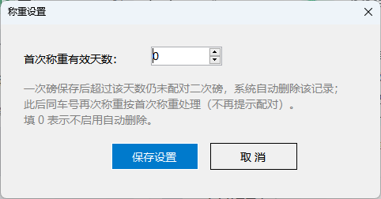

*图 5-2　称重设置（超期未配对的一次磅自动清理）*

---

## 6. 视频监控与自动抓拍

### 6.1 看监控

- **主界面右下角**就是实时监控画面（最多显示多路，双列排布）；
- **双击任意一路画面**，弹出大屏窗口看得更清楚，关掉大屏不影响后台录像流和抓拍；
- 也可以走菜单：**视频 → 视频监控**。

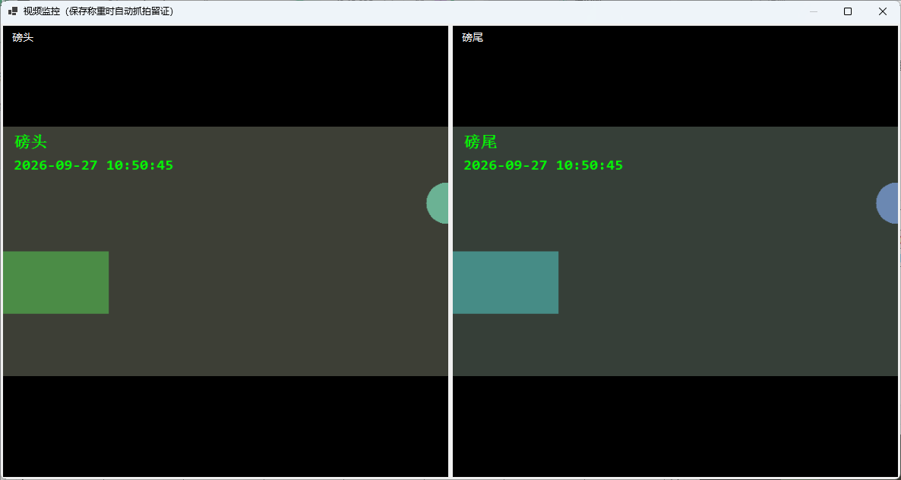

*图 6-1　视频监控大屏（多路画面平铺，可同时看磅头磅尾）*

### 6.2 什么时候自动拍照

**保存一次磅成功后**和**二次磅结算成功后**，每个摄像头**各拍 1 张**照片，自动按"日期 + 流水号"存到 `captures` 文件夹。保存时状态栏会提示"已抓拍 N 张存证图片"。

以后随时能回看：**记录 → 记录查询 → 选中记录 → 查看抓拍**。

### 6.3 添加 / 修改摄像头（管理员）

菜单：**视频 → 摄像头设置**

1. 勾选"启用视频监控与抓拍"；
2. 每行填一路：**名称**（如"磅头""磅尾"）+ **取流地址**；
3. 点"添加摄像头"加一路，选中行点"删除选中行"减一路；
4. 点保存，**立即生效**（不用重启软件）。

**取流地址哪里来？**

- 用萤石 / 慧眼智巡平台摄像头：在平台的"快速集成"里生成地址（推荐 **HTTP-FLV** 格式，延迟 1~3 秒最清楚；RTMP 也支持），复制粘贴进来；
- 用支持 RTSP 的网络摄像头：填摄像头自己的 RTSP 地址（如 `rtsp://用户名:密码@192.168.1.64:554/...`）。

> **调试小技巧：** 地址先留空，该路会显示"模拟画面"（渐变背景 + 移动色块），用来确认软件视频功能本身正常，再填真实地址。

> 萤石平台的取流地址**有有效期**，过期后画面会黑屏/提示取流失败，去平台重新生成一个填进来即可。

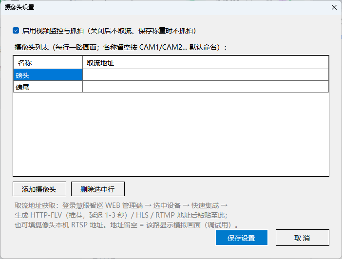

*图 6-2　摄像头设置（一行一路：名称 + 取流地址；保存后立即生效）*

---

## 7. 查记录、补打磅单、导出

菜单：**记录 → 记录查询**

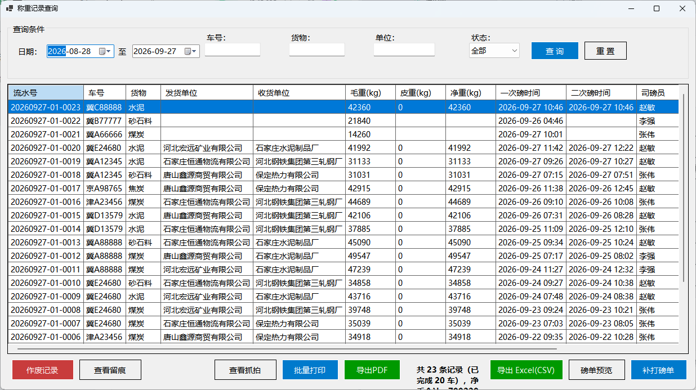

*图 7-1　记录查询（上方筛选条件、中间结果列表、底部合计与各操作按钮）*

### 7.1 查记录

顶部条件想填哪个填哪个（都可以不填）：

- 日期范围（默认最近 30 天）
- 车号、货物、单位
- 状态：全部 / 已完成 / 未完成 / 已作废

点"查询"，或在任意条件框按**回车**。下方列表显示结果，最底部自动合计**总条数、车数、净重总和**。

### 7.2 单条记录的操作

先点选中一条记录，再点对应按钮：

| 按钮 | 用途 |
|---|---|
| **补打磅单** | 重新打印这一张磅单（只对"已完成"的记录） |
| **磅单预览** | 先在屏幕上看版式效果，不耗纸 |
| **查看抓拍** | 看这条记录当时自动拍的照片，双击照片可放大 |
| **导出 Excel(CSV)** | 把**当前查到的所有记录**导成表格，Excel 双击就能打开 |

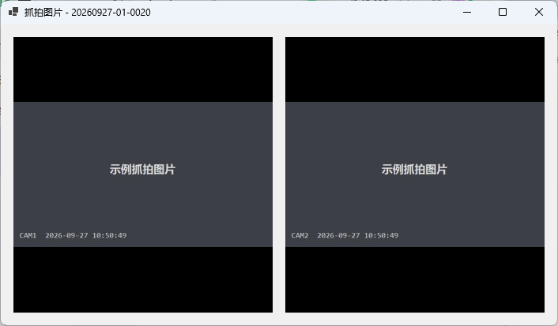

*图 7-2　查看抓拍（显示该车过磅时自动拍下的存证照片，此处为示例图片）*

### 7.3 批量打印 / 导出 PDF

按住 **Ctrl** 逐条点、或按住 **Shift** 选一串，选中多条"已完成"记录后：

- **批量打印**：多张磅单合成一个打印任务，一次打完；
- **导出PDF**：选一个文件夹，每张磅单存成一个 PDF 文件（用 Windows 自带的 "Microsoft Print to PDF" 打印机，Win10/11 都有）。

### 7.4 作废与留痕（仅管理员）

- **作废记录**：选中要作废的记录 → 点"作废记录" → **必须填写作废原因**。作废后状态变"已作废"，数据保留、可查，但不能打单；车可重新过磅。
- **查看留痕**：查看这条记录从头到尾被谁作废过、为什么作废，全程有记录，防止抵赖。

---

## 8. 报表统计

菜单：**报表 → 报表统计**

选**报表类型**和**日期范围**，自动出结果（只统计"已完成"的记录）：

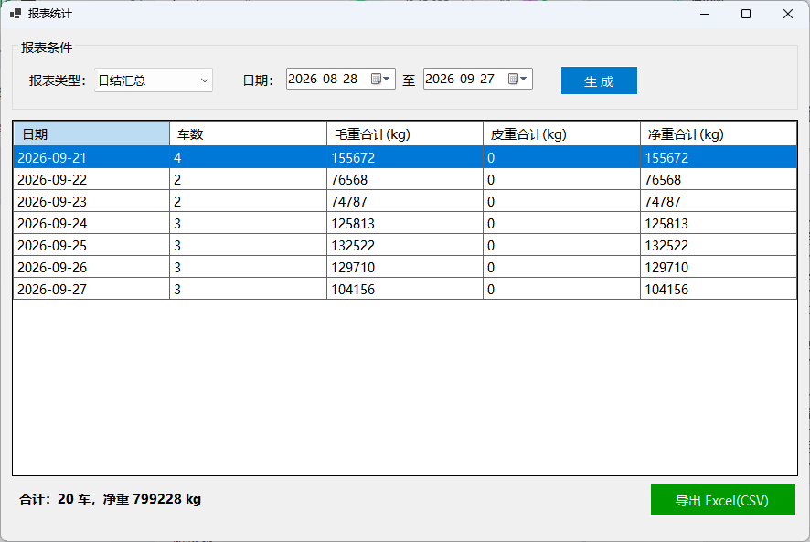

*图 8-1　报表统计（按日/货物/单位/车号/司磅员汇总）*

| 报表 | 回答的问题 |
|---|---|
| 日结汇总 | 每天过了多少车、多少吨？ |
| 按货物汇总 | 每种货物各拉了多少？ |
| 按发货单位汇总 | 每家发货单位各发了多少？ |
| 按收货单位汇总 | 每家收货单位各收了多少？ |
| 按车号汇总 | 每辆车各拉了几趟、多少吨？ |
| 按司磅员汇总 | 每个操作员各经手了多少车？ |

结果底部有总合计。点"**导出 Excel(CSV)**"可以把报表存成表格文件发给别人。

---

## 9. 自定义字段

**这是什么？** 每个磅房想多记的东西不一样：有的要记"订单号"，有的要记"料仓号"。自定义字段就是**自己给录入界面加输入项**。

菜单：**资料 → 基础资料管理**

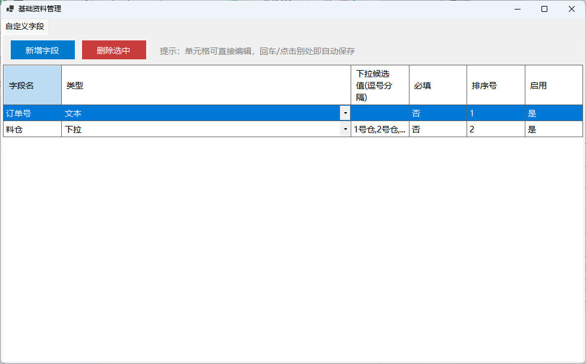

*图 9-1　基础资料管理（自定义字段：名称 / 类型 / 下拉候选值 / 必填 / 启用）*

- **新增字段**：点"新增字段"，输入名称（如"订单号"），选类型（文本 / 数字 / 日期 / 下拉），点确认；
  - 选"下拉"类型时，在"下拉候选值"里用**逗号隔开**填选项（如：1号仓,2号仓,3号仓）；
  - 勾"必填"后，不填就不能保存称重；
- **修改**：直接在表格里点单元格改，回车保存；
- **停用**：把"启用"改成"否"（暂时不用这个字段，但历史记录里的数据还在）；
- **删除**：选中行点"删除选中"。

加好字段后，重新打开主界面，录入区会多出这个输入框；记录查询里多一列；磅单模板里也能用它。

---

## 10. 串口设置（连接地磅仪表）

**什么时候用它？** 主界面"● 通讯"红灯、重量不动、或换了仪表/电脑之后。

菜单：**数据源 → 串口参数设置**

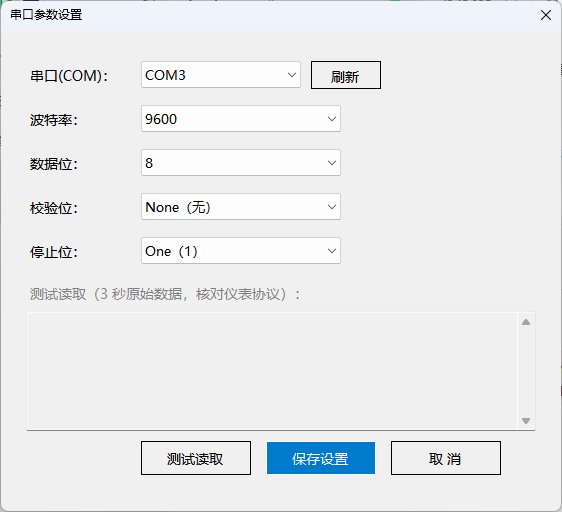

*图 10-1　串口参数设置（含"测试读取"原始数据窗口，用于排查通讯问题）*

### 10.1 常规设置

1. **串口(COM)**：下拉选仪表接的口（不知道是哪个 COM？见下面"测试读取"找），点"刷新"可重新枚举；
2. **波特率**：按仪表说明书选，常见 9600；
3. **数据位 / 校验位 / 停止位**：按仪表说明书，最常见组合是 **8 / 无 / 1**；
4. 点确定，**立即按新参数重连，不用重启软件**。

### 10.2 测试读取（强烈推荐用来排查）

点"**测试读取**"，软件按当前参数打开串口收 3 秒原始数据，显示"十六进制 + 可见字符"两段：

- **有数据且看起来正常** → 串口和参数对，问题在别处；
- **完全没数据** → 按软件给的 3 条建议逐个查：
  1. COM 口选错了（拔插一下 USB 转串口线，看"刷新"后哪个口新出现）；
  2. 波特率/校验位和仪表设置不一致；
  3. 串口线接法不对（问仪表厂家要"交叉线"还是"直连线"）。

再点一次"测试读取"可提前停止。

---

## 11. 磅单打印设置

菜单：**系统 → 打印设置**（管理员）

| 设置项 | 说明 |
|---|---|
| 打印模板 | 选"不使用模板-内置版式"用下面的常规设置；选某个模板则按模板版式打（见第 12 章） |
| 纸张 | A4（普通打印机）/ 241×140 / 241×93（针式打印机的连续纸） |
| 联数 | 一式 1~3 联，逐页打出 |
| 自动打印 | 勾上 = 结算完直接弹打印；不勾 = 每次弹窗问要不要打 |
| 磅单字段 | 勾选 = 磅单上打印这一项，不勾 = 不打印（比如不需要"批次"就取消勾选） |

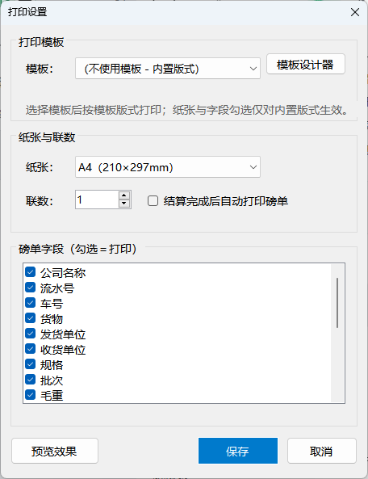

*图 11-1　打印设置：上部选纸张 / 联数 / 自动打印与字段勾选，下部为磅单预览*

窗口下方有**预览效果**，用一条示例数据实时显示磅单打出来长什么样，调到满意再保存。

> 用针式打印机打两联三联纸时，软件会自动切换成紧凑两列版式，内容超高自动缩小，不会截断。

---

## 12. 磅单模板（自己设计磅单样式）

内置版式不够用？可以像"画图"一样自己拖出一张磅单。

### 12.1 模板库

菜单：**系统 → 打印设置 → 管理模板**

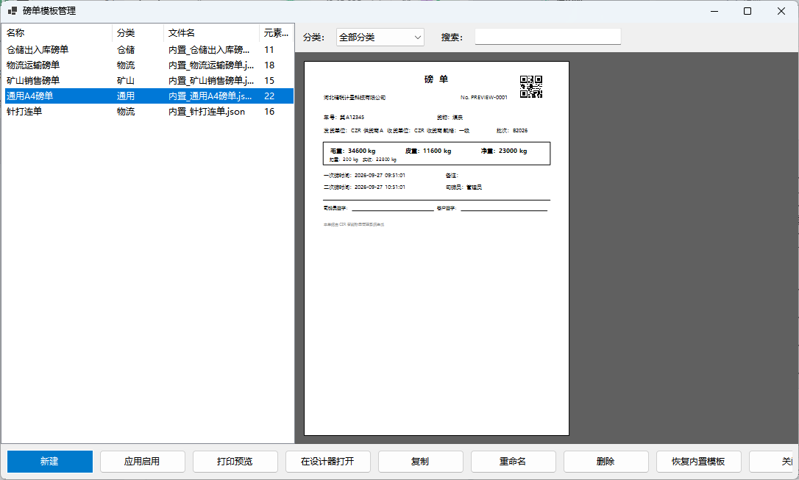

*图 12-1　模板库：左侧是模板列表，右侧实时预览磅单效果*

软件自带 **5 个现成模板**：通用 A4 磅单、物流运输磅单、仓储出入库磅单、矿山销售磅单、针打连单。

- 选中点"**应用启用**"→ 之后所有磅单按这个模板打；
- 点"**打印预览**"看效果；
- 点"**复制**"生成一个副本再改，不动原模板；
- 改坏了点"**恢复内置模板**"一键还原；
- 点"**在设计器打开**"进入自由编辑（见下）。

### 12.2 模板设计器

像用画图/Word 文本框一样：

1. **加元素**：双击或拖动左侧工具箱（文本、线条、矩形框、图片、表格、签名区、二维码、条形码）到画布；
2. **摆放**：鼠标拖动位置，拖右下角小方块调大小；
3. **填内容**：文本元素里可以写死文字（如公司名），也可以点"**插入到文本**"插入**占位符**（如 `{车号}`、`{净重}`），打印时自动替换成真实数据；
4. **改层级**：选中元素点上移/下移一层；
5. **撤销**：Ctrl+Z 撤销，Ctrl+Y 重做（最多 50 步）；
6. 保存后回到打印设置，选中该模板即启用。

**占位符小技巧：**

- `{净重:F1}` → 小数只留 1 位；
- `{一次磅时间:yyyy-MM-dd}` → 时间只显示年月日；
- 车号、毛重、皮重、净重、扣重、司磅员、备注、打印时间等 20 多项都能插，自定义字段也能插；
- 条形码/二维码内容也支持占位符（比如把流水号做成条形码方便扫码）。

---

## 13. 用户管理

菜单：**系统 → 用户管理**（仅管理员）

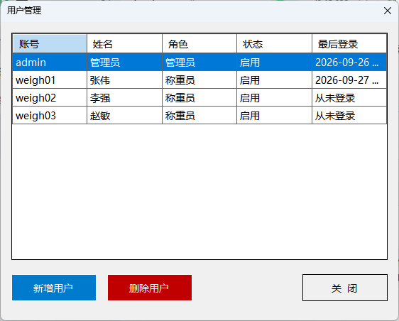

*图 13-1　用户管理：新增 / 删除用户、重置密码、启用停用*

**角色只有两种：**

| 角色 | 能做什么 |
|---|---|
| **称重员** | 日常称重、查记录、打单、导出、改自己密码、备份 |
| **管理员** | 称重员全部权限 + 用户管理、作废记录、打印设置、称重设置、模板管理、数据库设置、摄像头设置 |

**常用操作：**

- **新增用户**：点"新增"，填账号（不能重复）、姓名、角色、初始密码（至少 6 位）。新用户**第一次登录必须改密码**；
- **删除用户**：选中点删除。**不能删自己**，系统也**必须保留至少一个启用的管理员**（防止把管理员删光谁也进不去）。

---

## 14. 修改密码

菜单：**系统 → 修改密码**

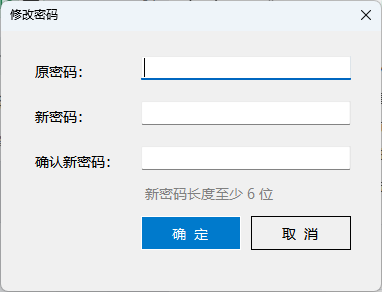

*图 14-1　修改密码*

依次填：原密码 → 新密码（至少 6 位）→ 再输一遍新密码，确定。有不对的地方会红字提示。

**建议：** 每个操作员 3~6 个月改一次密码；不要用 123456、生日这类弱密码。

---

## 15. 数据备份与恢复

### 15.1 自动备份（默认已开启）

软件**每天自动**把数据库备份到安装目录的 `backups` 文件夹（保留最近 30 份，超过自动删最旧的），不用人工管。

### 15.2 手动备份

菜单：**系统 → 备份数据** → 选保存位置（默认文件名 `backup_时间.db`）→ 保存。

**建议：** 每周把最新备份拷到 U 盘或网盘一份，防电脑硬盘坏掉。

### 15.3 恢复数据

菜单：**系统 → 恢复数据**

1. 弹窗提醒"恢复前建议先备份当前数据"——**照做**；
2. 选以前备份的 `.db` 文件；
3. 再确认一次，软件用它覆盖当前数据库；
4. **重启软件生效**。

> 恢复是"整库覆盖"：恢复之后，备份时间点之后新产生的记录会没有。所以一定要先备份当前数据。

---

## 16. 数据库设置（单机版 / 网络版）

菜单：**系统 → 数据库设置**（管理员）


*图 16-1　数据库设置：单机 SQLite 与网络 SQL Server 切换，可"测试连接"*

| 模式 | 适合场景 | 说明 |
|---|---|---|
| **Sqlite（单机版）** | 只有一台电脑过磅 | 免安装免配置，数据存在本机 `data\weigh.db`，默认就是它 |
| **SqlServer（网络版）** | 多台电脑同时过磅、数据共享 | 需要公司有 SQL Server 服务器 |

切到网络版：选 SqlServer → 填连接字符串（找网管要）→ 点"**测试连接**"通过后保存 → **重启软件**生效。

> 网络版的备份由数据库服务器统一负责，软件里的本地备份/恢复按钮会禁用。

---

## 17. 常见问题与故障排查

**问：打开软件"● 通讯"红灯，重量不动？**
1. 检查地磅仪表电源开着、串口线两端插紧；
2. 菜单"数据源 → 串口参数设置"，用"**测试读取**"看有没有数据；
3. 没数据 → 换 COM 口挨个试 / 核对波特率 / 换串口线（见第 10 章）；
4. 有数据但红灯 → 参数对不上，按仪表说明书改波特率/校验位。

**问：重量数字一直橙色"动态"，不让保存？**
车没停稳、磅上有晃动，或仪表一直在跳数。等数字稳定变绿即可。频繁误判可让管理员在 config.json 调大稳定容差（`StableToleranceKg`，默认 5kg）。

**问：保存按钮点不了 / 弹"未稳定"？**
重量还没稳定，等绿色"稳定"灯亮再保存。

**问：弹"超载"？**
重量超过地磅量程设置（默认 100 吨）。车开下磅确认；若量程设置错了找管理员改 config.json 的 `MaxCapacityKg`。

**问：监控画面黑屏 / 提示取流失败？**
1. 萤石平台地址**过期了**（最常见）→ 去平台重新生成地址，更新到"摄像头设置"；
2. 网络不通 → 检查电脑能否上网、摄像头在线状态；
3. 软件会自动不停重试，修好后画面自己恢复。

**问：忘了 admin 密码 / 账号锁死了？**
等 10 分钟锁定期结束；密码忘了解决办法：用另一管理员账号登录改密；只有一个管理员且忘密码 → 用最近的 `backups` 备份恢复（或联系软件维护人员处理数据库）。

**问：磅单打出来字体太小 / 位置不对？**
用模板设计器自己调（第 12 章），或打印设置里换纸张/勾选字段（第 11 章）。

**问：电脑换了 / 重装系统，数据怎么迁？**
把整个安装目录拷到新电脑，或新装软件后把旧目录的 `config.json` + `data` 文件夹拷过去（见 2.2 节）。

**问：导出的 CSV 用 Excel 打开是乱码？**
不会。软件导出的 CSV 已带编码标记（UTF-8 BOM），Excel 双击直接正常打开。若用很老的 Excel 2003，用"数据 → 导入"方式打开。

**问：想看谁动过数据？**
管理员在记录查询里"查看留痕"；日常操作明细看安装目录 `logs` 文件夹里按天记录的日志文件。

---

## 18. 附录：软件目录说明

安装目录下这些文件夹/文件是软件运行产生的，**不要手动删改**：

| 路径 | 内容 |
|---|---|
| `config.json` | 全部配置（串口、打印、摄像头、备份等） |
| `data\weigh.db` | 称重数据库（记录、账号、留痕全在里面） |
| `logs\日期.txt` | 按天记录的操作日志 |
| `backups\backup_*.db` | 自动/手动备份文件 |
| `captures\日期\流水号_camN.jpg` | 称重时自动抓拍的照片 |
| `templates\*.json` | 磅单模板 |

**config.json 常用配置速查（改完需重启软件）：**

| 配置项 | 含义 | 默认值 |
|---|---|---|
| `ScaleNo` | 磅号（显示在标题和磅单上） | 01 |
| `CompanyName` | 公司名称（磅单抬头） | CZR 称重有限公司 |
| `Unit` | 重量显示单位：kg / t | kg |
| `MaxCapacityKg` | 最大量程(kg)，超过判超载 | 100000 |
| `StableCount` / `StableToleranceKg` | 稳定判定：连续次数 / 容差(kg) | 3 / 5 |
| `WeightDecimalDigits` | 仪表隐含小数位（帧数字 4001 = 40.01kg 时填 2） | 2 |
| `UnfinishedWarnHours` | 一次磅几小时没完成列表标红 | 24 |
| `FirstWeighExpireDays` | 一次磅超几天自动清理，0=不清理 | 0 |
| `AutoBackupEnabled` / `AutoBackupDays` / `AutoBackupKeep` | 自动备份开关 / 间隔天数 / 保留份数 | 开 / 1 / 30 |
| `ConfirmBeforeSave` | 保存前是否二次确认 | 开 |

---

*本说明书随软件版本更新，如有疑问请联系软件维护人员。*
