# 精锐计量称重软件 使用说明书

**适用版本：V1.0.0**

本说明书面向磅房操作员和管理员，把软件里的**每一个功能、每一处设置**都用通俗的语言讲清楚，并配上真实界面截图。不需要懂电脑专业知识，照着做即可。

---

## 目录

1. [软件是干什么的](#1-软件是干什么的)
2. [安装软件](#2-安装软件)
3. [登录](#3-登录)
4. [认识主界面](#4-认识主界面)
5. [日常称重操作（最常用）](#5-日常称重操作最常用)
6. [收费设置（自动算过磅费）](#6-收费设置自动算过磅费)
7. [视频监控与自动抓拍](#7-视频监控与自动抓拍)
8. [查记录、补打磅单、作废、导出](#8-查记录补打磅单作废导出)
9. [黑匣子（无人值守自动记录）](#9-黑匣子无人值守自动记录)
10. [报表统计](#10-报表统计)
11. [自定义字段](#11-自定义字段)
12. [打印设置](#12-打印设置)
13. [磅单模板（模板库与设计器）](#13-磅单模板模板库与设计器)
14. [综合设置 F3（总控中心）](#14-综合设置-f3总控中心)
15. [用户管理与权限](#15-用户管理与权限)
16. [修改密码与屏幕锁定](#16-修改密码与屏幕锁定)
17. [数据备份与恢复](#17-数据备份与恢复)
18. [常见问题与故障排查](#18-常见问题与故障排查)
19. [附录：软件目录说明](#19-附录软件目录说明)

---

## 1. 软件是干什么的

本软件用于**地磅称重管理**，核心工作方式是"**两次称重**"：

- 车辆拉货进厂，**空车先上磅**称皮重（空车去皮），或**重车先上磅**称毛重（重车过磅）——先称哪个都行；
- 装货/卸货后再称另一次，软件自动把**大的当毛重、小的当皮重**，算出**净重**（货物实际重量）并打印磅单。

除了称重，软件还能：

- 实时显示地磅重量，稳定/动态/超载、通讯状态一目了然；
- 连接摄像头看监控，称重保存时**自动拍照留证**；
- **黑匣子**：重量稳定压磅达到设定秒数就自动记录 + 抓拍，无人值守也有据可查；
- 按净重**自动计算过磅费**（按重量分段收固定金额或按吨计费）；
- 查询历史记录、补打磅单、作废留痕、导出 Excel；
- 日报表、按货物/单位/车号/司磅员汇总统计；
- 自己设计磅单样式（拖拽式模板设计器）；
- 数据自动备份；可对接"公平计量平台"自动上传记录。

---

## 2. 安装软件

### 2.1 安装

双击安装包（例如 `精锐计量称重软件_安装包_V1.0.0.exe`），按向导一路"下一步"即可：

- 默认安装到 `C:\精锐计量称重软件`（可以点"浏览"换到其他磁盘）；
- 建议勾选"创建桌面快捷方式"，以后从桌面双击图标打开软件。

> **提示：** 软件自带 .NET 运行时，不需要安装任何其他环境，装完即用。

### 2.2 升级 / 换新电脑

想沿用原来的**串口配置、登录密码、称重记录**？只需把旧安装目录里的两个东西拷到新安装目录：

- `config.json`（配置文件）
- `data` 文件夹（里面的 `weigh.db` 是数据库）

### 2.3 卸载

从 Windows"设置 → 应用"里找到"精锐计量称重软件"卸载。

> **放心卸载：** 卸载只删程序本身，称重记录、配置、照片都会保留在安装目录里。

---

## 3. 登录

打开软件先登录：

*图 3-1　登录界面（账号密码已自动填好默认值）*

| 项目 | 说明 |
|---|---|
| 默认账号 | admin（已自动填好） |
| 初始密码 | 111111 |
| 操作 | 输入密码后直接按回车键即可登录 |

**几个保护规则：**

- **第一次登录必须改密码**（用初始密码登录后会自动弹出改密码窗口，改完才能进系统）；
- 密码连着输错多次，账号会**锁定一段时间**（10 分钟），防止别人乱猜密码；
- 想换账号：菜单「**系统 → 注销并重新登录**」。

---

## 4. 认识主界面

登录后进入主界面。软件打开时**默认全屏**，从上到下分为四块：

*图 4-1　主界面全貌（图中视频区为演示画面，重量与记录均为示例数据）*

### 4.1 顶部：称重条与快捷方式

*图 4-2　顶部称重条：左快捷方式｜空车去皮｜大屏重量｜重车过磅｜右快捷方式*

- **左侧快捷方式**：记录查询、报表统计、视频监控、基础资料，点一下直接打开对应窗口；
- **中间两个大按钮**：**空车去皮**（蓝色）和**重车过磅**（绿色），是每天用得最多的按钮（见第 5 章）；
- **中间大数字**：地磅实时重量，下方一排是**指示灯**；
- **右侧快捷方式**：计算器、退出。

**重点看三个指示灯：**

| 指示灯 | 颜色含义 | 怎么处理 |
|---|---|---|
| ● 通讯 | **绿色** = 正常收到地磅仪表数据；**红色** = 收不到 | 红色说明仪表没连上，见 [第 18 章](#18-常见问题与故障排查) 排查 |
| ● 稳定/动态 | **绿色"稳定"** = 重量读数稳了，可以保存；**橙色"动态"** = 数字还在跳，不能保存 | 等车停稳、数字不跳了再操作 |
| ● 超载 | **红色** = 超过地磅最大量程 | 把车开下去，禁止保存 |

### 4.2 中部：视频监控 + 今日统计卡片

中部是 **3 个摄像头画面槽位**（最多 3 路，双击任意画面放大成大屏）。画面右上角悬浮着**今日称重统计卡片**：

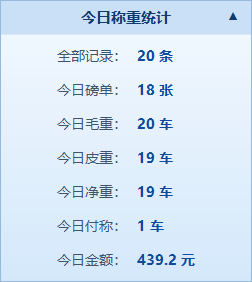

*图 4-3　今日统计卡片（点击标题条可收起/展开）*

卡片内容：**全部记录、今日磅单、今日毛重（车数）、今日皮重（车数）、今日净重（车数）、今日付称、今日金额（元）**。"付称"指只称了重车还没回来称空车的车数。点一下标题条可以把卡片收起来，不挡监控画面。

### 4.3 底部：称重记录列表

底部是当天的称重记录列表（与录入窗口字段一致：车牌、品种、地主、毛/皮/净重、金额等）：

- **双击未完成的行**：自动带车牌打开录入窗口，直接结算二次磅；
- 右上角可选**显示条数**：20 / 50 / 70 / 100 条；
- 右上角还有 **kg / 吨**切换开关，切完列表、统计、磅单全部跟着换单位。

### 4.4 最底部：状态栏

从左到右：**数据源**（串口号等）｜ **操作提示**（刚做完的动作结果）｜ **时钟**。

### 4.5 菜单栏一览

主界面最上面一排菜单，所有功能都从这里进：

| 菜单 | 里面有什么 |
|---|---|
| 系统 | 修改密码、注销并重新登录、备份数据、恢复数据、用户管理、打印设置、**综合设置**、**收费设置**、磅单模板管理、数据库设置、退出 |
| 记录 | 记录查询、**黑匣子记录** |
| 报表 | 报表统计 |
| 资料 | 基础资料管理（自定义字段） |
| 数据源 | 串口参数设置 |
| 视频 | 视频监控、摄像头设置 |

> **快捷键 F3：** 管理员按键盘 **F3** 直接打开"综合设置"。

---

## 5. 日常称重操作（最常用）

### 5.1 两种称重方式

点主界面顶部的大按钮进入录入窗口：

- **空车去皮**：车是空的（准备装货，或卸完货），称的是**皮重**；
- **重车过磅**：车装着货，称的是**毛重**。

两个窗口长得一样，只是**颜色和标题不同**：空车去皮是**蓝底**，重车过磅是**绿底**，一眼就能分清现在称的是哪种。窗口里点「**切 换**」按钮可以在两种模式之间互换。

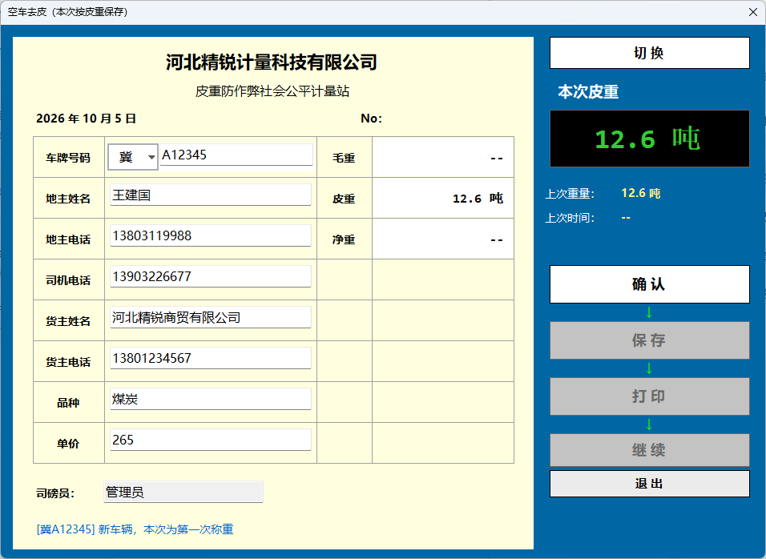

*图 5-1　空车去皮录入窗（蓝底；右侧显示上次皮重供参考）*

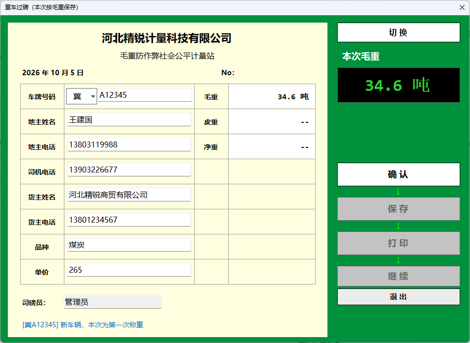

*图 5-2　重车过磅录入窗（绿底；重量、票据字段为示例数据）*

### 5.2 窗口布局

- **左侧**是一张米黄色的"过磅单"票据：填车牌号码、地主姓名/电话、司机电话、货主姓名/电话、品种、单价；右半边实时显示**毛重/皮重/净重**预览；司磅员自动填当前登录人，不用管；
- **右侧**从上到下：切换按钮 → **本次重量大字**（实时跳动）→ 四步操作按钮。

### 5.3 车牌怎么填

1. 点省份框（车牌第一个字），弹出 8 列×4 行的省份网格，选一个（如"冀"）；
2. 在右边编号框里输入字母数字。**双击编号框**会弹出**字母触摸面板**，可以连续点选字母（触摸屏好用），也可以直接用键盘打：

*图 5-3　车牌字母面板（双击编号框弹出，可连续点选）*

3. **省事功能**：当天保存过的车牌，输一半就会自动弹出候选；选中后，**上次填的品种、地主、货主、单价会自动带出来**，不用重复录入。

### 5.4 四步操作：确认 → 保存 → 打印 → 继续

右侧四个按钮是**链式**的，按顺序逐步解锁（灰=还没到，白=当前可点，绿=已完成）：

1. **确认**：核对车牌、等重量稳定后点它，重量读数被**锁定**；此时如果这辆车有待配对的一次磅，会显示流水号提示"将结算二次磅"；
2. **保存**：
   - 第一次称 → 存为一次磅（未完成）；
   - 这辆车已有一次磅 → 自动**结算**：毛重=两次大的、皮重=小的、净重=差值，启用收费时同时算出**金额**；
   - 保存时摄像头**自动抓拍**留证；
3. **打印**：直接打出磅单，不弹"是否打印"询问；
4. **继续**：清空票据，**窗口不关**，下一辆车直接接着录。

都办完了点「**退 出**」回主界面。

### 5.5 两个贴心的防错设计

- **上次皮重参考**：空车去皮时，右侧显示这辆车**上次**的皮重和时间。本次皮重和上次差得太多（超过综合设置里"空车去皮差值预警"的吨数），会**弹窗预警**——可能是车上还压着东西，或车牌输错了（只提醒，不拦着保存）；
- **防重复称重**：可以设置"严格禁止 X 分钟内二次称重"、"仪表不归零不允许保存"（在综合设置里，见第 14 章）。

---

## 6. 收费设置（自动算过磅费）

**这是什么？** 磅房按车收过磅费。设置好收费标准后，**二次磅结算时软件按净重自动算出金额**，记录查询里有"金额(元)"列，主界面统计卡有"今日金额"。

菜单：**系统 → 收费设置**（管理员）

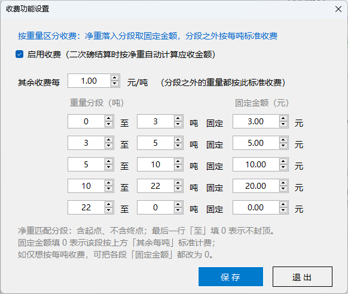

*图 6-1　收费设置（按重量分段收固定金额，分段之外按每吨收费）*

**规则（看图对照）：**

- 勾上「启用收费」才会计算；
- **重量分段**：净重落进某段（含起点、不含终点）就收该段的**固定金额**。如 0～3 吨收 3 元、10～22 吨收 20 元；
- 最后一行「至」填 **0** 表示不封顶（22 吨以上都算这段）；
- 某段固定金额填 **0** = 该段不收固定钱，改按上方「**其余收费每 X 元/吨**」计费；
- 如果只想"按吨计费"，把各段固定金额都填 0 即可。

默认收费标准：0-3 吨 3 元、3-5 吨 5 元、5-10 吨 10 元、10-22 吨 20 元、22 吨以上按 1 元/吨。改完点「保 存」，**下一次结算立即生效**。

---

## 7. 视频监控与自动抓拍

### 7.1 看监控

- 主界面中部就是实时监控画面（最多 3 路）；
- **双击任意一路画面**弹出**大屏窗口**，看得更清楚。关掉大屏不影响后台取流和抓拍；
- 也可以点顶部快捷方式「视频监控」或走菜单「视频 → 视频监控」。

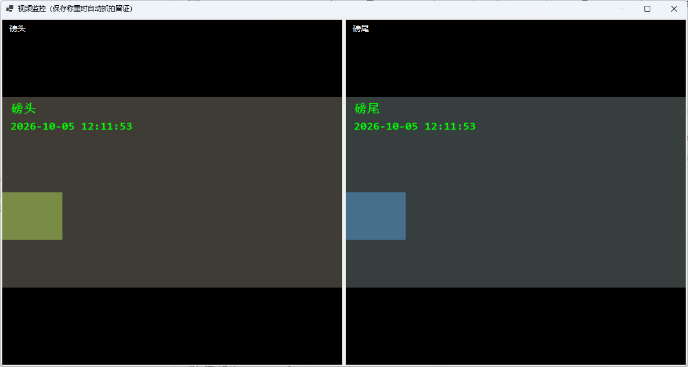

*图 7-1　视频监控大屏（多路画面平铺，左上角是摄像头名称；本图为演示画面）*

### 7.2 什么时候自动拍照

- **保存称重时**（一次磅、二次磅结算都会拍）：每路摄像头各拍一张，存到 `captures\日期\流水号_cam1.jpg` 这样的文件里；
- **黑匣子触发时**（见第 9 章）。

照片随时可以在"记录查询 → 查看抓拍"里调出来看：

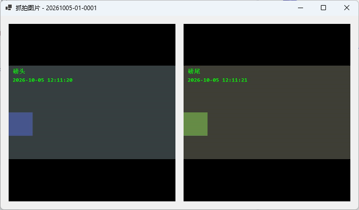

*图 7-2　查看抓拍（双击图片可调出系统看图工具看原图）*

### 7.3 摄像头设置

菜单：**视频 → 摄像头设置**（管理员；也在综合设置「视频设置」页签里）

*图 7-3　摄像头设置：一行一路，填 IP / 端口 / 用户名 / 密码*

- 顶部总开关「启用视频监控与抓拍」，关掉后不取流、保存时也不抓拍；
- **最多 3 路**，一行一张卡片：名称（如"磅头"）+ 局域网 **IP 地址** + 端口 + 用户名 + 密码；
  - 端口默认 **554**（海康/萤摄像头通用）；
  - 用户名默认 **admin**；密码是摄像头激活时设置的管理密码；
  - **IP 留空 = 这一路不启用**；
- 「**搜索设备**」自动找出局域网里的摄像头（列出 IP/型号/MAC），点"填入"自动填卡；
- 「**测试连接**」按填的信息试着取一路画面，通了再保存；
- 点「保存设置」后**立即生效**，不用重启软件。

> 画面黑屏/提示"无画面：取流失败或超时"时，先点「测试连接」验证账号密码和 IP 是否正确。

---

## 8. 查记录、补打磅单、作废、导出

菜单：**记录 → 记录查询**（或点顶部快捷方式「记录查询」）

*图 8-1　记录查询（上方筛选条件、中间结果、底部合计与操作按钮；数据为示例）*

### 8.1 查

按**日期范围、车号、货物、单位、状态**（全部/已完成/未完成/已作废）任意组合筛选，点「查 询」（条件框里按回车也行）。表格列出流水号、车牌、品种、地主/货主信息、单价、毛/皮/净重、**金额**、两次称重时间、司磅员、状态等列；底部显示**共几条、几车、净重合计**（只统计已完成）。

### 8.2 底部按钮一览

| 按钮 | 谁能用 | 干什么 |
|---|---|---|
| 作废记录 | 管理员 | 把选中的已完成记录作废（必须填原因，永久留痕，不可恢复） |
| 查看留痕 | 管理员 | 查看这条记录的修改/作废历史（谁、什么时候、为什么） |
| 查看抓拍 | 所有人 | 看这车过磅时自动拍的照片 |
| 磅单预览 | 所有人 | 屏幕上预览磅单效果，不出纸 |
| 补打磅单 | 所有人 | 重新打印磅单（只有"已完成"的能补打；打印次数有限制，见第 14 章） |
| 导出 Excel(CSV) | 所有人 | 把查询结果存成表格文件发给别人 |

### 8.3 作废怎么操作

录错了（车号/重量/货物）想重来？记录**不能改**（防作弊设计），只能作废：

1. 选中那条记录，点「作废记录」；
2. 在弹窗里**必须填写作废原因**：

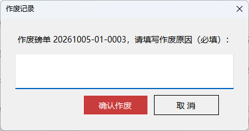

*图 8-2　作废记录（原因必填，会永久留痕）*

3. 点「确认作废」。这条记录状态变为"已作废"，之后这辆车重新过磅即可。

> 作废不是删除：记录还在，随时能在"查看留痕"里查到是谁、为什么作废的。开了平台对接的话，作废动作也会同步到平台。

---

## 9. 黑匣子（无人值守自动记录）

**这是什么？** 像飞机黑匣子一样：**重量稳定压磅达到设定秒数，软件自动记下重量并抓拍**，不管有没有人在操作、有没有点保存。用来回答"昨晚/中午有没有车偷偷上过磅"这类问题。

菜单：**记录 → 黑匣子记录**

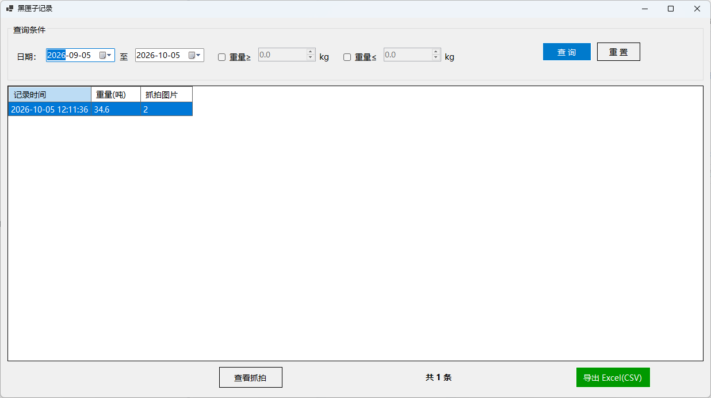

*图 9-1　黑匣子记录（按日期与重量范围查询；数据为示例）*

- **查**：按日期范围 + 重量上下限（勾上"重量≥/≤"再填数）筛选；
- **查看抓拍**：看该次自动抓拍的照片；
- **导出 Excel(CSV)**：导出留档。

**触发条件（默认开着）**：重量 ≥ 200 kg 且稳定持续 10 秒 → 自动记录 + 抓拍；重量变化后重新稳定会再次计时。同一稳定过程只记一次，不会刷屏。

**参数在哪改**：综合设置 → 基本设置 → "黑匣子"区块（启用开关、触发重量、持续秒数），见第 14 章。改完保存立即生效。

---

## 10. 报表统计

菜单：**报表 → 报表统计**（或顶部快捷方式「报表统计」）

*图 10-1　报表统计（6 种汇总方式；数据为示例）*

选**报表类型**和**日期范围**，点「生 成」（打开时自动出默认报表）：

| 类型 | 回答什么问题 |
|---|---|
| 日结汇总 | 每天各过了几车、多少吨？ |
| 按货物汇总 | 煤炭、焦炭各拉了多少？ |
| 按发货单位汇总 | 每家发货单位各发了多少？ |
| 按收货单位汇总 | 每家收货单位各收了多少？ |
| 按车号汇总 | 每辆车各拉了几趟、多少吨？ |
| 按司磅员汇总 | 每个操作员各经手了多少车？ |

报表只统计"已完成"的记录，底部有总合计。点"**导出 Excel(CSV)**"可以把报表存成表格文件发给别人。

---

## 11. 自定义字段

**这是什么？** 每个磅房想多记的东西不一样：有的要记"订单号"，有的要记"料仓号"。自定义字段就是**自己给系统加记录项**。

菜单：**资料 → 基础资料管理**（或顶部快捷方式「基础资料」）

*图 11-1　基础资料管理（自定义字段；数据为示例）*

- **新增字段**：点「新增字段」输入名称（如"订单号"），选类型（文本 / 数字 / 日期 / 下拉）：
  - 选"下拉"类型时，在"下拉候选值"里用**逗号隔开**填选项（如：1号仓,2号仓,3号仓）；
  - "必填"设为"是"后，称重保存时必须填它；
- **修改**：直接在表格里点单元格改，回车/点别处即自动保存；
- **排序号**：控制在界面上的显示顺序；
- **停用**：把"启用"改成"否"（暂时不用，历史记录里的数据还在）；
- **删除**：选中行点「删除选中」。

加好字段后，过磅单录入、记录查询、磅单模板里都能用到它。

---

## 12. 打印设置

菜单：**系统 → 打印设置**（管理员）

*图 12-1　打印设置：模板选择、纸张与联数、磅单字段勾选*

| 设置项 | 说明 |
|---|---|
| 打印模板 | 选"不使用模板 - 内置版式"用下面的常规设置；选某个模板则按模板版式打（见第 13 章）。右侧「模板设计器」「管理模板」直接进入模板功能 |
| 纸张 | A4（普通打印机）/ 241×140 / 241×93（针式打印机连续纸） |
| 联数 | 一式 1~3 联，逐页打出 |
| 自动打印 | 勾上 = 结算完直接出单；不勾 = 每次弹窗问 |
| 磅单字段 | 勾选 = 磅单上打印这一项（比如不需要"批次"就取消勾选） |

点「**预览效果**」用一条示例数据即时预览磅单，调到满意再点「保存」。

> 用针式打印机打两联三联纸时，软件自动切换成紧凑两列版式，内容超高自动缩小，不会截断。

---

## 13. 磅单模板（模板库与设计器）

内置版式不够用？可以像"画图"一样**自己拖出一张磅单**。

### 13.1 模板库

菜单：**系统 → 磅单模板管理**（或打印设置 → 「管理模板」）

*图 13-1　模板库：左侧模板列表（可按分类/搜索过滤），右侧实时预览*

软件自带 **5 个现成模板**（通用 A4 磅单、公平计量磅单等）。常用操作：

- 选中点「**应用启用**」→ 之后所有磅单按这个模板打（当前启用的模板整行高亮）；
- 「**打印预览**」看效果；「**复制**」生成副本再改，不动原模板；
- 「**重命名**」「**删除**」「**恢复内置模板**」（改坏了一键还原）；
- 「**新建**」「**在设计器打开**」进入自由编辑（列表里**双击**也行）。

### 13.2 模板设计器

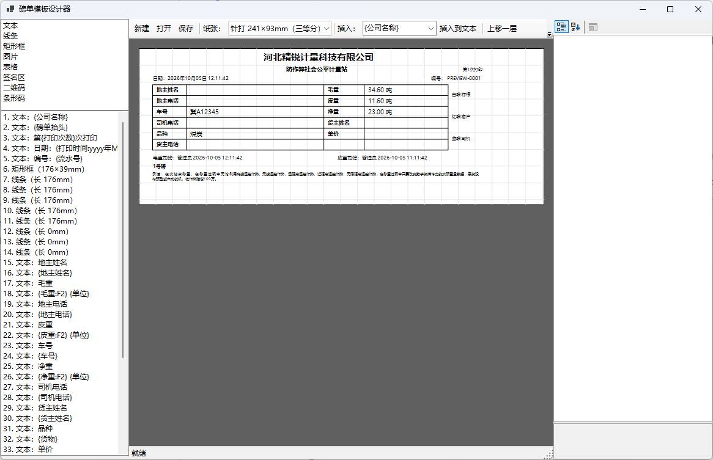

*图 13-2　模板设计器：左侧工具箱与元素列表、中间毫米网格画布、右侧属性面板*

像用画图/Word 文本框一样：

1. **加元素**：双击或拖动左侧工具箱（**文本、线条、矩形框、图片、表格、签名区、二维码、条形码**）到画布；
2. **摆放**：鼠标拖位置，拖右下角红手柄调大小；Delete 键删除；
3. **填内容**：文本元素里可写死文字（如公司名），也可以用「插入到文本」插入**占位符**（如 `{车号}`、`{净重}`），打印时自动换成真实数据；
4. **改属性**：选中元素在右侧属性面板改字体、颜色等；工具栏可上移/下移一层；
5. **撤销**：Ctrl+Z 撤销、Ctrl+Y 重做（最多 50 步）；
6. 「保存」后回打印设置（或模板库）选中该模板即启用。

**占位符小技巧：**

- `{净重:F1}` → 小数只留 1 位；
- `{一次磅时间:yyyy-MM-dd}` → 时间只显示年月日；
- 车号、毛/皮/净重、扣重、司磅员、备注、打印时间等 20 多项都能插，自定义字段也能插；
- 条形码/二维码内容也支持占位符（比如把流水号做成条形码方便扫码）。

---

## 14. 综合设置 F3（总控中心）

菜单：**系统 → 综合设置**，或直接按键盘 **F3**（仅管理员）。这里是软件的"总控制台"，共 **5 个页签**：**基本设置、高级设置（串口）、联网设置（数据库）、平台对接、视频设置（摄像头）**。改完点右上角「**保 存**」立即生效。

### 14.1 基本设置

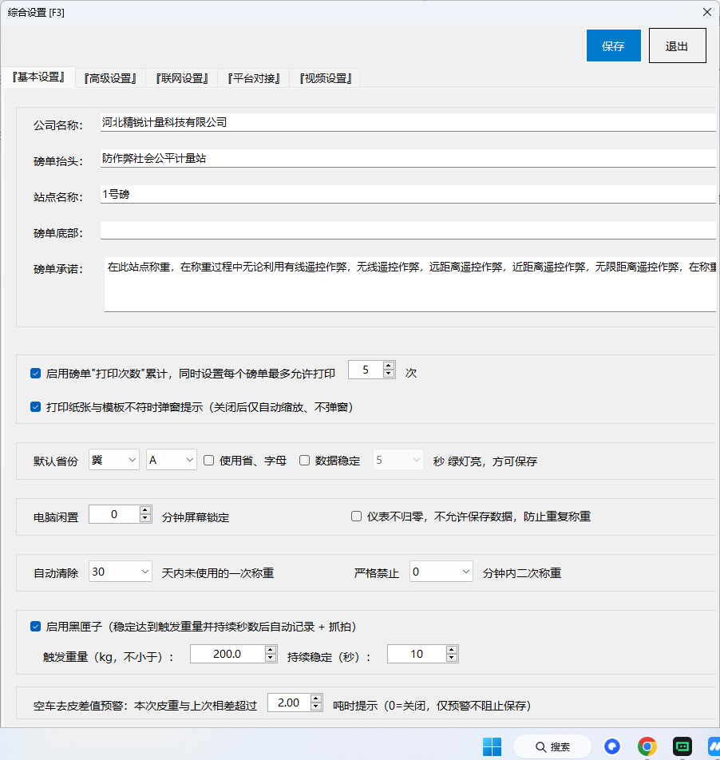

*图 14-1　综合设置「基本设置」页（7 个区块）*

从上到下逐个区块说明：

**① 公司信息**（打印在磅单上）

| 项目 | 用途 |
|---|---|
| 公司名称 | 磅单抬头的大标题，也是录入窗票据的公司名 |
| 磅单抬头 | 磅单副标题（如"防作弊社会公平计量站"） |
| 站点名称 | 抬头下方的小字（如"1号磅"），留空不打印 |
| 磅单底部 / 磅单承诺 | 打在磅单页脚 / 承诺行的文字 |

**② 磅单打印次数累计**：勾上后每张磅单**限制最多打印 N 次**（默认 5 次），防止重复打单作弊；下面一项是"打印纸张与模板不符时弹窗提示"（关掉就只自动缩放不提醒）。

**③ 默认省份 + 数据稳定**：设默认省份简称和发牌机关字母（勾"使用省、字母"后，录入窗车牌自动预填，如 黑+D）；"数据稳定"勾上并选秒数后，重量必须**稳定保持 X 秒**绿灯才亮、才允许保存（更严格，防止刚停稳就急着保存）。

**④ 闲置锁屏 + 归零拦截**：电脑闲置 X 分钟后自动**锁定屏幕**（0 = 不锁，见第 16 章）；勾"仪表不归零，不允许保存数据"后，上一车保存完、仪表没回零之前不能保存下一车（防止重复称重）。

**⑤ 自动清除 + 严格禁止**：一次磅超过 X 天（1~30）没回来称二次，自动清除（默认 30 天）；"严格禁止 X 分钟内二次称重"：刚结算完的同车号 X 分钟内再称会被拒绝（0 = 不限制）。

**⑥ 黑匣子**：启用开关 + **触发重量**（默认 200 kg，过滤行人/空磅）+ **持续稳定秒数**（默认 10 秒）。见第 9 章。

**⑦ 空车去皮差值预警**：本次皮重与本车上次已完成皮重相差超过 X 吨时弹窗预警（0 = 关闭；只提醒不拦保存）。

### 14.2 高级设置 = 串口参数

*图 14-2　综合设置「高级设置」页 = 串口参数设置（"测试读取"用于排查）*

连接地磅仪表的参数：

1. **串口(COM)**：下拉选仪表接的口，点「刷新」重新枚举（拔插一下 USB 转串口线，看哪个口新出现就是它）；
2. **波特率**：按仪表说明书，常见 9600；
3. **数据位 / 校验位 / 停止位**：最常见组合 **8 / 无 / 1**；
4. 点「保存设置」**立即按新参数重连，不用重启软件**。

**测试读取（排查神器）**：点一下，软件按当前参数收 3 秒原始数据，显示"十六进制 + 可见字符"两段：

- **有数据** → 串口和参数对，问题在别处；
- **完全没数据** → 挨个查：① COM 选错了；② 波特率/校验位和仪表不一致；③ 串口线该用交叉线还是直连线（问仪表厂家）。

### 14.3 联网设置 = 数据库

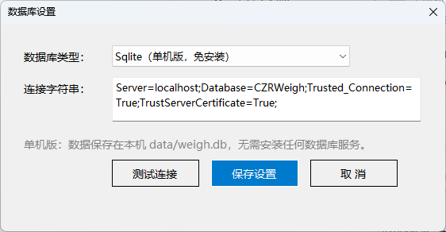

*图 14-3　综合设置「联网设置」页 = 数据库设置*

| 模式 | 适合场景 | 说明 |
|---|---|---|
| **Sqlite（单机版）** | 只有一台电脑过磅 | 免安装免配置，数据存在本机 `data\weigh.db`，默认就是它 |
| **SqlServer（网络版）** | 多台电脑同时过磅、数据共享 | 需要公司有 SQL Server 服务器 |

切到网络版：选 SqlServer → 填连接字符串（找网管要）→ 点「**测试连接**」通过后保存 → **重启软件**生效。

### 14.4 平台对接

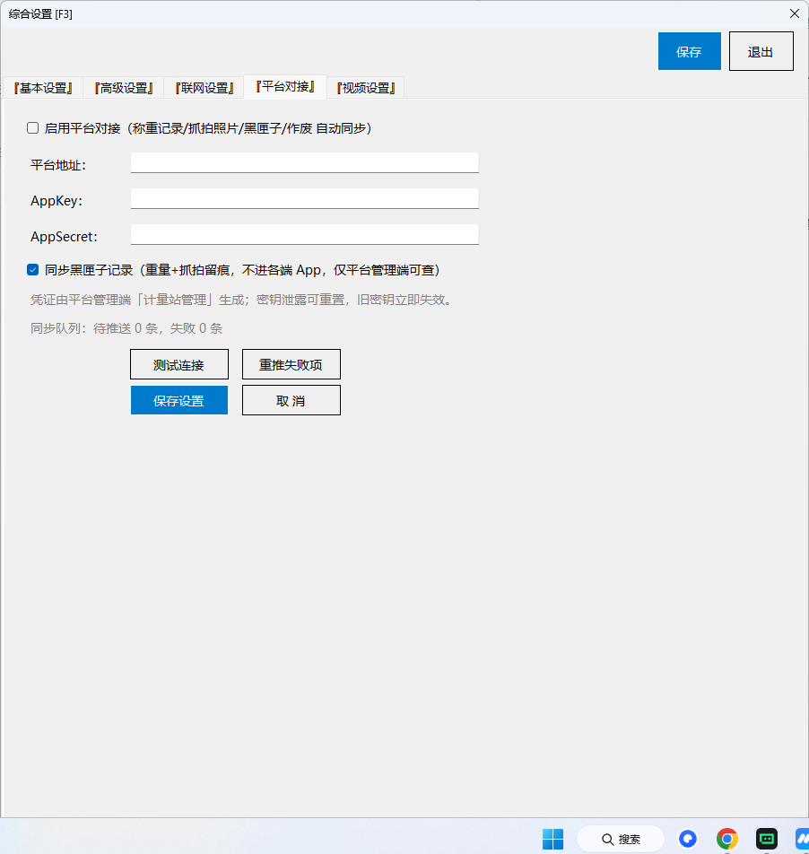

*图 14-4　综合设置「平台对接」页（对接"公平计量平台"，凭证由平台管理端生成）*

开启后，软件把**结算记录、抓拍照片、黑匣子、作废**四类数据自动上传到公平计量平台（管理端"计量站管理"生成 AppKey/AppSecret 填进来）：

- 「**测试连接**」验证密钥、时钟和网络；
- 下方实时显示本地推送队列状态（待推/成功/失败）；
- **断网也没事**：推不出去的先排队，网络恢复自动续传；失败的改完配置可点「**重推失败项**」；
- 勾"同步黑匣子记录"后，黑匣子留痕（重量+照片）也同步，仅供平台管理端查询。

### 14.5 视频设置

内容与「视频 → 摄像头设置」完全相同（见第 7.3 节），在这里保存同样立即生效。

---

## 15. 用户管理与权限

菜单：**系统 → 用户管理**（仅管理员）

*图 15-1　用户管理（账号/姓名/角色/状态/最后登录）*

**角色只有两种：**

| 角色 | 能做什么 |
|---|---|
| **称重员** | 日常称重、查记录、补打、导出、改自己密码、备份 |
| **管理员** | 称重员全部权限 + 用户管理、作废记录、查看留痕、打印设置、综合设置、收费设置、模板管理、数据库设置、摄像头设置 |

**新增用户**：点「新增用户」：

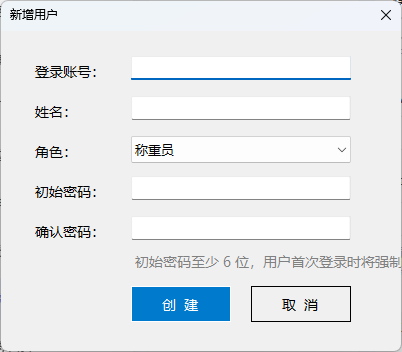

*图 15-2　新增用户（初始密码至少 6 位，首次登录强制修改）*

填账号（不能重复）、姓名、角色、初始密码（至少 6 位，输两遍）。新用户**第一次登录必须改密码**。

**删除用户**：选中点「删除用户」。**不能删自己**，系统也**必须保留至少一个启用的管理员**（防止把管理员删光谁也进不去）。

---

## 16. 修改密码与屏幕锁定

### 16.1 修改密码

菜单：**系统 → 修改密码**

*图 16-1　修改密码（新密码至少 6 位）*

依次填：原密码 → 新密码（至少 6 位）→ 再输一遍，确定。有不对的地方会提示。

> **建议：** 每个操作员 3~6 个月改一次密码；不要用 123456、生日这类弱密码。

### 16.2 屏幕锁定

综合设置里设了"电脑闲置 X 分钟屏幕锁定"后，长时间不操作软件会自动全屏锁定：

*图 16-2　闲置自动锁屏（输当前登录账号的密码解锁）*

**解锁办法**：输入**当前登录账号**的密码（和登录同一套验证，乱猜同样会锁定）。锁屏期间外人看不到任何数据、动不了软件。

---

## 17. 数据备份与恢复

### 17.1 自动备份（默认已开启）

软件**每天自动**把数据库备份到安装目录的 `backups` 文件夹（保留最近 30 份，超过自动删最旧的），不用人工管。

### 17.2 手动备份

菜单：**系统 → 备份数据** → 选保存位置（默认文件名 `backup_时间.db`）→ 保存。

**建议：** 每周把最新备份拷到 U 盘或网盘一份，防电脑硬盘坏掉。

### 17.3 恢复数据

菜单：**系统 → 恢复数据**

1. 弹窗提醒"恢复前建议先备份当前数据"——**照做**；
2. 选以前备份的 `.db` 文件；
3. 再确认一次，软件用它覆盖当前数据库；
4. **重启软件生效**。

> 恢复是"整库覆盖"：恢复之后，备份时间点之后新产生的记录会没有。所以一定要先备份当前数据。

---

## 18. 常见问题与故障排查

**问：打开软件"● 通讯"红灯，重量不动？**
1. 检查地磅仪表电源开着、串口线两端插紧；
2. 综合设置 → 高级设置（或菜单"数据源 → 串口参数设置"），用「**测试读取**」看有没有数据；
3. 没数据 → 换 COM 口挨个试 / 核对波特率 / 换串口线；
4. 有数据但红灯 → 参数对不上，按仪表说明书改波特率/校验位。

**问：重量数字一直橙色"动态"，不让确认？**
车没停稳、磅上有晃动，或仪表一直在跳数。等数字稳定变绿即可。嫌太严或太松：管理员在综合设置里调整"数据稳定"秒数（config.json 的 `StableToleranceKg` 容差也可调）。

**问：弹"超载"？**
重量超过地磅量程设置（默认 100 吨）。车开下磅确认；若量程设错了找管理员改 config.json 的 `MaxCapacityKg`。

**问：监控画面黑屏 / 提示取流失败？**
1. 摄像头设置里点「**测试连接**」，验证 IP/账号/密码；
2. 检查摄像头电源和网线、电脑能否 ping 通摄像头 IP；
3. 萤石云平台转发的地址**会过期**，优先使用摄像头局域网直连（IP + 端口 + 密码）方式；
4. 软件会自动不停重试，修好后画面自己恢复。

**问：忘了 admin 密码 / 账号锁死了？**
等 10 分钟锁定期结束；用另一管理员账号登录改密；只有一个管理员且忘密码 → 用最近的 `backups` 备份恢复（或联系软件维护人员处理数据库）。

**问：想补打磅单，提示打印次数超限？**
综合设置 → 基本设置里"每个磅单最多允许打印 N 次"。确属业务需要，管理员可调大后再补打。

**问：金额算得不对？**
检查收费设置：分段起止是否写反（终点必须大于起点）、该段固定金额是否填 0（填 0 = 按"其余每吨"计费）、净重是否落进了预想的分段（含起点、不含终点）。

**问：同一辆车想连续称两次一次磅？**
不行。同车号有一次磅没完成时，保存会走二次磅结算——先结算完，或让管理员作废旧记录。

**问：磅单打出来字体太小 / 位置不对？**
用模板设计器调整元素大小与位置（见第 13.2 节），或换一个合适的纸张/模板。

**问：屏幕突然锁住了？**
闲置自动锁屏。输入当前登录账号的密码解锁（见第 16.2 节）。

**问：黑匣子没记录？**
检查综合设置 → 黑匣子是否启用、触发重量是否设得太高（车重必须 ≥ 触发重量且稳定持续满设定秒数才记录）。

---

## 19. 附录：软件目录说明

安装目录下的重要文件与文件夹：

| 路径 | 是什么 |
|---|---|
| `config.json` | 全部配置（串口、摄像头、收费、综合设置、平台对接等）。换电脑/升级时拷它 |
| `data\weigh.db` | 称重数据库（记录、用户、黑匣子等）。备份/恢复就是备份/恢复它 |
| `captures\日期\` | 称重与黑匣子的自动抓拍照片（按流水号命名） |
| `templates\` | 磅单模板文件（JSON），内置模板会自动生成 |
| `backups\` | 每日自动备份的数据库文件 |
| `logs\` | 运行日志（排障用，可删） |

---

*本说明书随软件版本更新，如有疑问请联系软件维护人员。*
